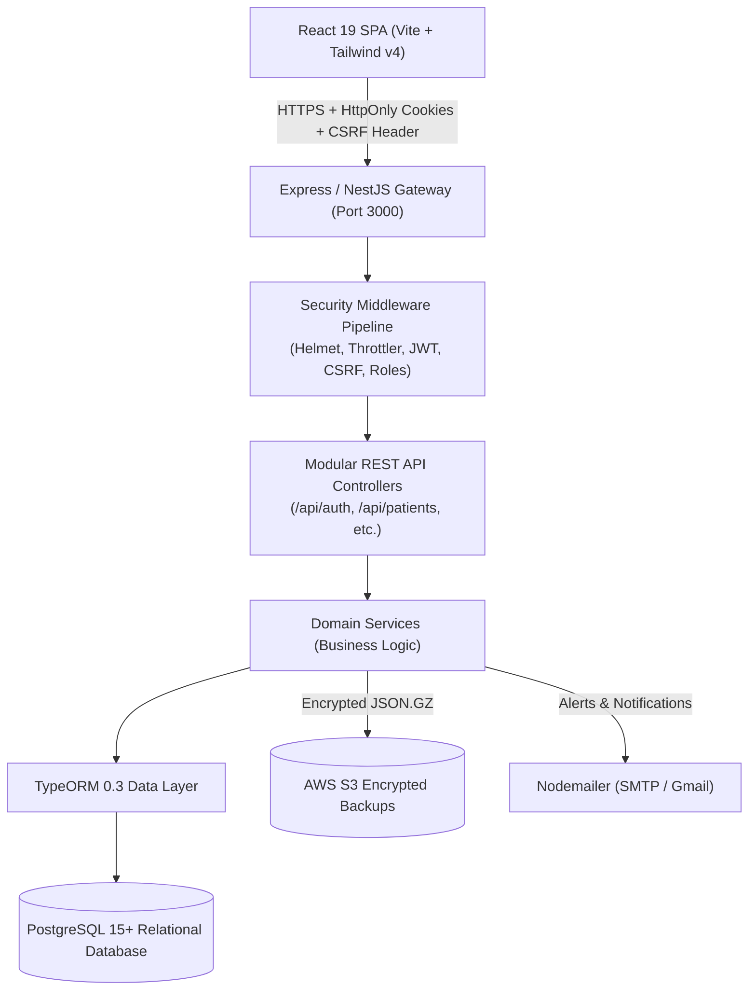

# 🏗️ EIRENE — System Architecture & Security Design

## 1. System Overview

**EIRENE** is built as a decoupled, multi-tier clinical web application designed for high availability, strong patient data isolation, and resilient auditing.



---

## 2. Security Pipeline & Request Lifecycle

Every incoming HTTP request traverses a defense-in-depth pipeline:

```mermaid
flowchart LR
    Req[Incoming Request] --> Helmet[1. Helmet Security Headers]
    Helmet --> CookieParser[2. Cookie Parser]
    CookieParser --> Throttler[3. Throttler Guard (Rate Limiter)]
    Throttler --> JwtAuth[4. JwtAuthGuard]
    JwtAuth --> Csrf[5. CsrfGuard (Double-Submit)]
    Csrf --> Roles[6. RolesGuard (RBAC)]
    Roles --> Handler[Controller Action Handler]
```

1. **Helmet Middleware:** Attaches `Content-Security-Policy`, `X-Frame-Options: DENY`, `X-Content-Type-Options: nosniff`, and `Strict-Transport-Security`.
2. **Cookie Parser:** Extracts `auth_token` and `csrf_token` from incoming cookies.
3. **Throttler Guard:** Enforces global rate limits (200 req/min) and strict limits on authentication endpoints (5 attempts/min with 15-minute lockout).
4. **JWT Auth Guard:** Inspects `auth_token` cookie, decodes payload, validates cryptographic signature using `JWT_SECRET`, and checks against `User.lastLogoutAt` for revocation.
5. **CSRF Guard:** Verifies that state-mutating requests (`POST`, `PUT`, `PATCH`, `DELETE`) contain an `X-CSRF-Token` header matching the signed cookie token via constant-time comparison (`crypto.timingSafeEqual`).
6. **Roles Guard:** Compares the user's role against `@Roles(...)` metadata attached to the controller handler.

---

## 3. Role-Based Access Control (RBAC) Matrix

| Endpoint Group | Super Admin | Admin | Doctor | Caregiver | Family Member | Public |
| :--- | :---: | :---: | :---: | :---: | :---: | :---: |
| `/api/auth/login` | ✅ | ✅ | ✅ | ✅ | ✅ | ✅ |
| `/api/auth/register` | ❌ | ❌ | ❌ | ❌ | ✅ | ✅ |
| `/api/admin/users/**` | ✅ | ✅ | ❌ | ❌ | ❌ | ❌ |
| `/api/channeling-slots/**` | ❌ | ✅ (Create) | ✅ (Update Status/Fee) | ❌ | ✅ (Read) | ❌ |
| `/api/prescriptions/**` | ❌ | ❌ | ✅ (Issue/Update) | ✅ (Read Active) | ✅ (Read Own) | ❌ |
| `/api/patients/vitals/**` | ❌ | ❌ | ✅ (Read) | ✅ (Record/Log) | ✅ (Read Own) | ❌ |
| `/api/payments/**` | ❌ | ✅ (Approve Bank Slips) | ❌ | ❌ | ✅ (Pay/Upload) | ❌ |
| `/api/backup/**` | ❌ | ✅ | ❌ | ❌ | ❌ | ❌ |

---

## 4. Disaster Recovery & Snapshot Encryption

* **Engine:** `BackupService` + `S3StorageService` (AWS SDK v3).
* **Payload:** Serialized JSON snapshot across clinical tables (`users`, `patients`, `prescriptions`, `vitals`, `care_plans`).
* **Compression:** GZIP stream compression (`.json.gz`).
* **Encryption:** AES-256 server-side encryption with SHA-256 integrity checksum verification.
